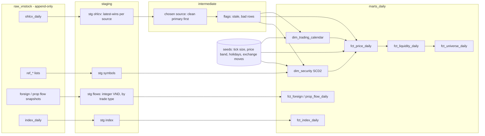

# vn-market-elt

**An ELT platform for Vietnamese equity market data - from the exchange feed to
a BigQuery warehouse and a Power BI dashboard, on free-tier infrastructure.**

> **Status:** the **cold path is built and verified** (P1-P3): 26 years of daily
> history in BigQuery, rebuilt by dbt into point-in-time marts, reconciled row by row
> against the previous system and guarded by data tests that are each proven able to fail.
> The hot path (intraday feed) is next. See the [changelog](CHANGELOG.md).

## What is built and how it is verified

| | |
|---|---|
| **History in BigQuery** | dlt loads every pull of the previous system's daily OHLCV (12 M+ rows, 2 sources, kept as an append-only log), the symbol lists, foreign and proprietary flows and index history (as content-hashed snapshots); every load is counted in the destination |
| **Point-in-time marts** | trading calendar (observed sessions, then weekdays minus seeded holidays), securities with exchange history (SCD2), clean daily prices with tick and band of the day, liquidity and universe, flows with the match / put-through split only where it adds up, index levels |
| **Reconciled, not just tested** | raw equals the source files per file (counts and date-weighted checksums); marts reproduce the previous system row by row, and every difference is named by its mechanism, not a tolerance |
| **Tests that can fail** | 100+ dbt data tests and unit tests with exact known answers; a planted-fault matrix on a synthetic DuckDB warehouse turns each non-built-in test red with a fault of its own mechanism (37 faults), in CI |
| **No look-ahead** | features downstream are rebuilt with every input cut at a date and must not change |
| **Keyless and cheap** | impersonation and Workload Identity Federation only; BigQuery and GCS free tiers |



## What it does (by design)

- **Cold path:** loads 26 years of daily prices for HOSE and HNX stocks into
  BigQuery and rebuilds them with dbt into a point-in-time warehouse: trading
  calendar, liquid universe, stale-session flags, exchange rules by date.
- **Hot path:** captures the intraday market feed over WebSocket and lands it
  in the warehouse in one-minute batches, so a dashboard refreshed at 09:20
  shows the market as of about 09:18.
- **Reconciles itself:** every model is checked against an independent
  reference answer, not only against its own tests.

## Highlights

| | |
|---|---|
| **Point-in-time by construction** | Universe membership, liquidity windows and disclosed data use only what was known at the time; truncation tests prove it |
| **Market rules as dated data** | Price bands, tick sizes, sessions and holidays are versioned seeds with `effective_from` / `effective_to`, ready for the HNX→HOSE consolidation on 2026-12-28 |
| **Raw is immutable** | Sources land verbatim and append-only; parsing happens in dbt, so a bug is fixed by rebuilding, never by re-fetching |
| **Keyless security** | No service-account key exists anywhere: attached identities on the VM, Workload Identity Federation in CI, SSH only through IAP |
| **Tests that can fail** | Every check ships with a planted fault that turns it red; a skipped check is reported as skipped, never as passed |
| **~$0 to run** | One e2-micro VM, BigQuery and GCS free tiers, manual BI refresh |

## Architecture

```
VPS WebSocket feed ─► collector (Compute Engine e2-micro) ─► parquet, 1-min batches ─► GCS ─► BigQuery raw
                                                                                              │
vnstock daily history ─► dlt ─────────────────────────────────────────────────────────────────┤
                                                                                              ▼
                                        dbt: staging ─► intermediate ─► marts (intraday views · daily tables)
                                                                                              │
                                                                                     Power BI Desktop
```

| Layer | Choice | Why |
|---|---|---|
| Capture | Python WebSocket client, systemd on a VM | Long-lived process with a stable disk |
| Extract-load | dlt, GCS load jobs | Load jobs are free; raw stays verbatim |
| Warehouse | BigQuery | Perpetual free tier |
| Transform and test | dbt | Lineage, tests and docs; portable across warehouses |
| BI | Power BI Desktop | Manual refresh keeps query cost near zero |
| Infrastructure | Terraform | Changes reviewed as a plan before they apply |
| CI | GitHub Actions | dbt runs on DuckDB with synthetic data - no cloud credentials in CI |

The same dbt project is later run on **Snowflake, Athena and Databricks** to
compare cost, speed and SQL portability.

## Vietnamese market specifics handled

Price bands of ±7 / ±10 % with wider ex-rights days · tiered tick sizes ·
ex-rights price adjustment with dividends quoted as a percentage of par ·
matched vs. put-through volume · HNX's post-close auction · a trading calendar
where a make-up Saturday is not a session · vendor histories rewritten after
corporate actions · the HNX→HOSE consolidation. Details:
[market microstructure](docs/knowledge/market-microstructure.md) ·
[data sources](docs/knowledge/data-sources.md) ·
[45 data-quality lessons](docs/knowledge/data-quality-lessons.md).

## Repository layout

```
docs/          spec, architecture decision records, domain knowledge
src/vnmarket/  collector and extract-load code (Python 3.11)
dbt/           staging, intermediate and mart models, seeds, tests
infra/         Terraform, systemd units, deploy script
config/        all thresholds and schedules (none hard-coded in Python)
tests/         synthetic fixtures only
```

## Roadmap

| Release | Scope |
|---|---|
| `v0.1.0` | Foundations: repository security, CI, infrastructure as code |
| `v0.2.0` ✅ | Cold path: history in BigQuery, dbt models, data-quality tests |
| `v0.3.0` - `v0.4.0` | Hot path: feed collector, streaming load, intraday dashboard |
| `v1.0.0` | Incremental loads, full security review, demo-ready |
| `v1.1`+ | Snowflake · Athena · Databricks comparison |

Progress is tracked in [milestones](../../milestones).

## Documentation

- [Specification](docs/spec.md) - goals, phases, latency budget, security design
- [Architecture decisions](docs/adr/README.md)
- [Engineering rules](docs/engineering-rules.md)
- [Project language: Vietnamese market terms](CONTEXT.md)
- [Contributing](CONTRIBUTING.md) · [Security policy](SECURITY.md)

The marts also feed a separate, private research project; nothing from it is published here.

## Data notice

No market data is stored in this repository. The vendors' terms do not allow
redistribution; tests and screenshots use synthetic data. Nothing here is
investment advice.

## License

[MIT](LICENSE)
