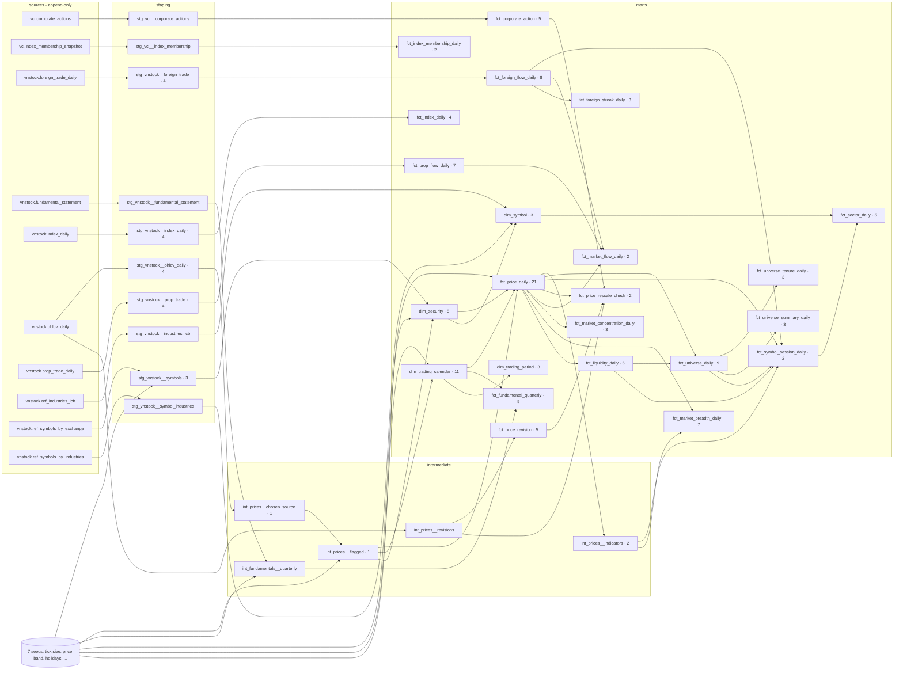

# dbt lineage

Generated by `tools/lineage_mermaid.py --apply` from dbt's manifest; do not edit by hand.
38 models, 10 source tables, 7 seeds; 131 data tests read at least one model. The number in each box is the data tests on that model (a test that reads two models counts in both).

